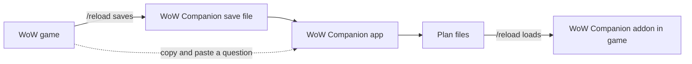

# WoW Companion

WoW Companion tells you what to do next in World of Warcraft. It plans your quests and draws the route on
your map. You can also ask about your character in plain words.

<!-- screenshot: map-plan.png — the world map with a numbered plan and the plan list open beside it -->

**Ready? → [Getting Started](docs/getting-started.md)**

> WoW Companion is a fan project. It is not affiliated with or endorsed by Blizzard Entertainment. World of Warcraft and Warcraft are trademarks of Blizzard Entertainment, Inc.

## What you get

- **A plan of what to do next**, drawn on your map with numbered steps.
- **Answers about your character**, in plain words. Type a question or click a suggestion.
- **Better gear, and how to get it.** You see where an upgrade comes from and how to make it.
- **Talents for how you like to play.** They come from a build that someone has worked out and checked.

## How it works

Three small pieces work together. Think of it as a loop.

- **The WoW Companion addon** writes down what your character has and what you see (trainers, vendors,
  gathering). WoW saves that to disk when you `/reload`, log out or quit. It is the one addon to install;
  ForeverScribe is optional now.
- **The WoW Companion app** is the small window that sits beside or over the game. It reads that save
  within seconds. It works out your plan and answers your questions. It writes the plan back for the addon.
- **The addon also shows** your plan in the game: on your map, on the minimap and in its own panel.

<!-- screenshot: overlay-beside-game.png — the whole screen, with the game and the app beside it -->

**The loop:** play, then type `/reload`. The app updates your plan within seconds. Type `/reload` again to
see it on your map.

**Asking:** you ask in the app. Type a question, or click a suggestion. In the game, a question button
copies a question for you. Paste it into the app's ask box.



**Safety, said simply:** the addons only read the game. The app never touches the game. Nothing is
automated. Your AI sees only what you ask it.

## Ask about your character

<!-- screenshot: overlay-answer.png — a question asked in the app and its answer -->

Type a question in the app, such as "What should I do next?". Or click one of the suggestions.

## What you need to set up

- **The WoW Companion addon** ([WoW-Companion/addon](https://github.com/WoW-Companion/addon)) records your character. It is the one addon you need. [ForeverScribe](https://github.com/MattMaximo/foreverscribe) is optional now: still read if present, and you can remove it once WoW Companion 0.6.N+ is installed.
- **The WoW Companion app** is the main thing. Download `WoW-Companion-Setup-<version>-x64.exe` from the
  [latest release](https://github.com/WoW-Companion/advisor/releases/latest). It works over the game in
  Windowed (Fullscreen) mode.

Every step is in [Getting Started](docs/getting-started.md). The [quickstart](docs/quickstart.md) goes deeper.

## For developers

The advisor is an MCP server that gives AI clients deterministic, character-aware advice backed by a
versioned Parquet game dataset. Tools today: `server_info`, `list_characters` and `character_brief`. A
Claude skill and a Windows setup guide are in [clients/](clients/) and [docs/try-it.md](docs/try-it.md).
You can run the advisor alone: `wowc-advisor serve --stdio` (default) or `serve --http --port 8000` (streamable HTTP at `/mcp`).
Download the advisor archive for Windows, macOS or Linux (amd64 or arm64) from the
[releases page](https://github.com/WoW-Companion/advisor/releases); it is one static program, not
code-signed (the quickstart explains the Windows and macOS warnings). Or with Go:
`go install github.com/WoW-Companion/advisor/cmd/wowc-advisor@latest`.

Point the server at a dataset directory (Parquet tables plus `manifest.json`) with
`--dataset DIR` or `WOWC_DATASET`. Without one, `server_info` reports "no dataset configured".

What the app is for, and the rules every feature follows, are in [docs/product-principles.md](docs/product-principles.md).

Client configuration for Claude Desktop, Claude Code, Codex, Antigravity CLI and Gemini CLI is in
[docs/clients.md](docs/clients.md).

## Character data

Character-aware advice reads the file the WoW Companion addon (and, if present, the [ForeverScribe](https://github.com/MattMaximo/foreverscribe)
addon, MIT) writes when you `/reload` or log out:
`WTF/Account/<account>/SavedVariables/WoWCompanion.lua` (or `ForeverScribe.lua`) inside your game folder (on Windows,
`World of Warcraft\_forever_\WTF\Account\<ACCOUNT>\SavedVariables\ForeverScribe.lua`). The advisor finds it itself on a standard install; otherwise point it
at it with `--savedvariables FILE` or `WOWC_SAVEDVARIABLES`; `server_info` then reports how many
characters it found, when they were captured and which game client version and build wrote them. The file is only read, on your machine, by a
parser that never executes it; it is never uploaded or written to. The format is documented in
[docs/foreverscribe-format.md](docs/foreverscribe-format.md).

## Development

```bash
make verify   # gofmt -l, go vet, go test
make build    # static binaries for six platforms in dist/ (git-ignored)
make bench    # DataStore benchmarks: point lookups and a range filter on a 32,000 row table
```

Go only; CGO is disabled for every build. Layout: `cmd/wowc-advisor` (the command) and `internal/`
(`lua` parser, `character` model, `brief`, `server` tools, `store` Parquet DataStore).

## License

MIT, see [LICENSE](LICENSE).
