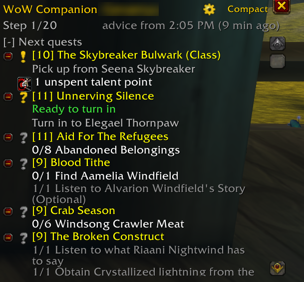
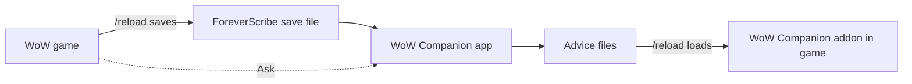

# WoW Companion

WoW Companion gives you advice for the character you are playing: what to do next, the best quest
route, and answers from your own AI. You see it in a small window beside the game and in a panel inside
WoW.



**New here? Start with [Getting Started](docs/getting-started.md)**, one short page for Windows players. The
full [quickstart](docs/quickstart.md) covers every path, from download to in-game advice.

> WoW Companion is a fan project. It is not affiliated with or endorsed by Blizzard Entertainment. World of Warcraft and Warcraft are trademarks of Blizzard Entertainment, Inc.

## How it works

Three small pieces work together. Think of it as a loop.

- **ForeverScribe** (an addon) writes down what your character has: level, quests, bags and talents.
  WoW only saves that to disk when you `/reload`, log out or quit.
- **The WoW Companion app** (the overlay, a small window beside the game) reads that save within seconds,
  works out your next steps and the best route, and lets you ask your AI about your character. It writes
  the advice back into the game's addon folder.
- **The WoW Companion addon** shows that advice in the game: the panel, the numbered route on your map and
  the minimap button. Quest counts update live as you play.

**The loop:** play, then `/reload` (WoW saves), then the app writes fresh advice within seconds, then
`/reload` again to see it in the game. You can also ask a question in the game; the app answers it in its
window right away.



**Safety, said simply:** the addon only reads the game. The app never touches the game. Nothing is
automated. Your AI sees only what you ask it.

## The pieces, in the order to set them up

- **ForeverScribe** ([MattMaximo/foreverscribe](https://github.com/MattMaximo/foreverscribe)), required: the
  addon that captures your characters into SavedVariables.
- **Overlay** ([overlay/](overlay/README.md)): a small Windows app (download `WoW-Companion-Setup-<version>-x64.exe`
  from the [latest release](https://github.com/WoW-Companion/advisor/releases/latest)) that bundles the advisor, sits over the
  game (Windowed (Fullscreen) only), finds your AI client and chats about the character you are playing.
  Recommended. It also answers questions you queue in game.
- **WoW Companion addon** ([WoW-Companion/addon](https://github.com/WoW-Companion/addon)), optional: in-game
  extras (the panel, tracker, tooltips and right-click "Ask about this", answered in the overlay after `/reload`).
- **Advisor** (this repo, `wowc-advisor`): the brain. An MCP server and command line that read your
  ForeverScribe capture and a game dataset, answer with ranked advice, and write the digest.
  `wowc-advisor companion` is a browser chat beside the game.

Setup for each, step by step, is the [quickstart](docs/quickstart.md).

## For developers

The advisor is an MCP server that gives AI clients deterministic, character-aware advice backed by a
versioned Parquet game dataset. Tools today: `server_info`, `list_characters` and `character_brief`. A
Claude skill and a Windows setup guide are in [clients/](clients/) and [docs/try-it.md](docs/try-it.md).
You can run the advisor alone: `wowc-advisor serve --stdio` (default) or `serve --http --port 8000` (streamable HTTP at `/mcp`).
Download the advisor archive for Windows, macOS or Linux (amd64 or arm64) from the
[releases page](https://github.com/WoW-Companion/advisor/releases); it is one static program, not
code-signed (the quickstart explains the Windows and macOS warnings). Or with Go:
`go install github.com/WoW-Companion/advisor/cmd/wowc-advisor@latest`.

Point the server at a dataset directory (Parquet tables plus `manifest.json`) with
`--dataset DIR` or `WOWC_DATASET`. Without one, `server_info` reports "no dataset configured".

Client configuration for Claude Desktop, Claude Code, Codex, Antigravity CLI and Gemini CLI is in
[docs/clients.md](docs/clients.md).

## Character data

Character-aware advice reads the file the [ForeverScribe](https://github.com/MattMaximo/foreverscribe)
addon (MIT) writes when you `/reload` or log out:
`WTF/Account/<account>/SavedVariables/ForeverScribe.lua` inside your game folder (on Windows,
`World of Warcraft\_forever_\WTF\Account\<ACCOUNT>\SavedVariables\ForeverScribe.lua`). The advisor finds it itself on a standard install; otherwise point it
at it with `--savedvariables FILE` or `WOWC_SAVEDVARIABLES`; `server_info` then reports how many
characters it found, when they were captured and which game client version and build wrote them. The file is only read, on your machine, by a
parser that never executes it; it is never uploaded or written to. The format is documented in
[docs/foreverscribe-format.md](docs/foreverscribe-format.md).

## Development

```bash
make verify   # gofmt -l, go vet, go test
make build    # static binaries for six platforms in dist/ (git-ignored)
make bench    # DataStore benchmarks: point lookups and a range filter on a 32,000 row table
```

Go only; CGO is disabled for every build. Layout: `cmd/wowc-advisor` (the command) and `internal/`
(`lua` parser, `character` model, `brief`, `server` tools, `store` Parquet DataStore).

## License

MIT, see [LICENSE](LICENSE).
