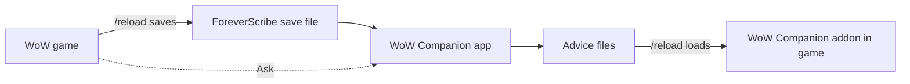
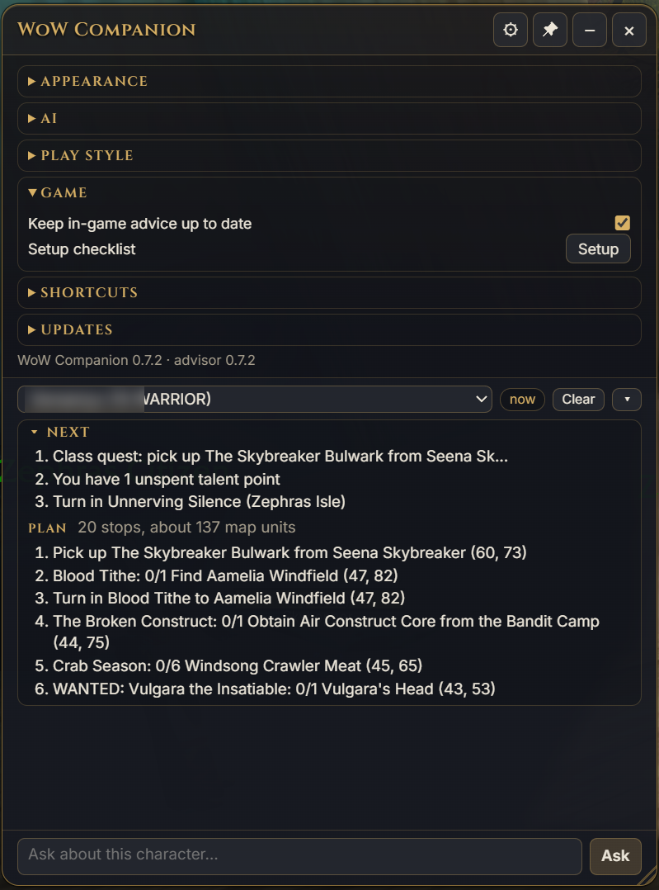
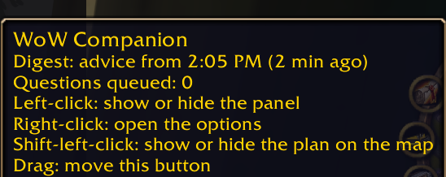

# Getting Started (alpha testers, Windows)

About 3 minutes to read, about 10 to do. Where you see `<account>`, use your own WoW account name.

## How it works

Three small pieces work together.

- **ForeverScribe** (an addon) writes down what your character has: level, quests, bags and talents.
  WoW only saves it to disk when you `/reload`, log out or quit.
- **The WoW Companion app** (the overlay, a small window beside the game) reads that save within seconds,
  works out your next steps and the best route, and lets you ask your AI about your character. It writes
  the advice back into the game's addon folder.
- **The WoW Companion addon** shows that advice in the game: the panel, the numbered route on your map and
  the minimap button. Quest counts update live as you play.

**The loop:** play, then `/reload` (WoW saves), then the app writes fresh advice within seconds, then
`/reload` again to see it in game. You can also ask a question in game; the app answers it in its window
right away.

**Safety, said simply:** the addon only reads the game. The app never touches the game. Nothing is
automated. Your AI sees only what you ask it.

## What you need

- **WoW: Forever** installed.
- **Windows 10 or 11 (64-bit).**
- **An account for one AI client.** Claude Code needs a Claude plan that includes it (Pro, Max, Team,
  Enterprise) or an Anthropic Console (API) account; the free Claude plan does not include it. See
  [Claude Code's setup page](https://code.claude.com/docs/en/setup). Codex signs in with a ChatGPT plan or an
  API key ([Codex](https://github.com/openai/codex)). For a Google account use
  [Antigravity CLI](https://antigravity.google/docs/getting-started?tab=cli) (`agy`). Gemini CLI is legacy: it works only with a paid Gemini API key
  ([Gemini CLI](https://github.com/google-gemini/gemini-cli)). Prices change, so look on those pages.
- **About 10 minutes.**

## Steps

1. **Install ForeverScribe (required).** Open the [ForeverScribe page](https://github.com/MattMaximo/foreverscribe)
   and put the addon in your game's `_forever_\Interface\AddOns` folder. Then quit WoW completely and start
   it again. WoW only notices a new addon when it starts. (The setup checklist in step 3 shows an "Open ForeverScribe page" button and tells you if it
   cannot find the addon.)
2. **Install WoW Companion.** On the [latest release](https://github.com/WoW-Companion/advisor/releases/latest)
   download `WoW-Companion-Setup-<version>-x64.exe` and run it. It needs no admin rights. Windows
   SmartScreen (Windows' safety check) will say it "protected your PC" because the installer is not code-signed: click
   **More info**, then **Run anyway**.
3. **Follow the setup checklist.** The app opens a **Setup** checklist with these lines: game found,
   ForeverScribe installed, ForeverScribe has data, WoW Companion addon (optional), display mode, Questie (optional), and game data.
   The checklist installs the addon if you want it. The first time it runs, it downloads a small game-data
   file (under 1 MB) from GitHub; nothing to install. Fix any red line with the button next to it. You can
   reopen it from the settings (the gear), under **Setup checklist**.

   

   **Questie is optional, and recommended.** With the Questie and QuestieDB addons installed, the advisor
   reads them on your own PC to suggest quests you have not picked up, with the giver's position, and to
   locate quests in your log. Without them it uses ForeverScribe's saved data alone. See
   [Questie interop](design/questie-interop.md).
   **The plan and the map.** With Questie, the overlay shows a numbered **Plan** under Next: an efficient order
   for your pick-ups, objectives and turn-ins. To see the plan's pins on the in-game map, you need WoW Companion
   addon 0.3.0 or newer; the setup checklist updates it.
4. **Install an AI client and sign in once.** Pick one; Claude Code gives the most detailed answers in
   our testing. Steps for each are under [Set up your AI client](#set-up-your-ai-client) below.
5. **Set WoW to Windowed (Fullscreen).** In WoW: System, Graphics, **Display Mode**, **Windowed (Fullscreen)**.
   Log in and type `/reload` once. That makes WoW save the file ForeverScribe wrote, so the app can read your character.
6. **Ask.** In the app, type: `What should I do next?`
7. **In the game: what you'll see.** Once the WoW Companion addon is installed, type `/reload` in game. You get the
   **panel** with your next steps (open it with `/wowc` or a click on the minimap button), the numbered route
   on your map, and a **minimap button**. Point at the button to see what each click does.

   

   

   Fresh advice shows after the app has written it: `/reload` (save), wait a few seconds, `/reload` again.

## Make it yours

Right-click the minimap button, or type `/wowc options`, to open the in-game options and change how the
panel and the route look.

## Set up your AI client

For every client the overlay finds it automatically. If it does not, press **Re-scan** in the overlay
settings (no restart needed), then press **Test** on the checklist's **AI client** line to confirm it
answers. Run PowerShell commands in a PowerShell window.

### Claude Code

- **Account:** a Claude plan that includes Claude Code, or an Anthropic Console account; the free Claude
  plan does not. See [Claude Code's setup page](https://code.claude.com/docs/en/setup).
- **Install:** `irm https://claude.ai/install.ps1 | iex`
- **Sign in once:** run `claude` in a terminal and follow the browser prompts. It must be signed in before
  it can answer headlessly.
- **Gotcha:** the installer puts `claude.exe` in `%USERPROFILE%\.local\bin`, which may not be on PATH, so
  `claude` may not work in a new terminal. The overlay looks there itself; add the folder to your user PATH
  only if you want to run `claude` in a terminal.

### Codex

- **Account:** a ChatGPT plan that includes Codex, or an API key. See [Codex](https://github.com/openai/codex).
- **Install:** `powershell -ExecutionPolicy ByPass -c "irm https://chatgpt.com/codex/install.ps1 | iex"`
- **Sign in once:** run `codex` and choose **Sign in with ChatGPT**.
- **Gotcha:** none known. If you install it while the overlay is open, just press **Re-scan**.

### Antigravity CLI (`agy`)

- **Account:** a Google account (free, Google AI Pro or Ultra). It replaced Gemini CLI for these accounts
  on June 18, 2026. See [Antigravity CLI](https://antigravity.google/docs/getting-started?tab=cli).
- **Install:** `irm https://antigravity.google/cli/install.ps1 | iex`
- **Sign in once:** run `agy` in a terminal and follow its prompts.
- **Gotcha:** run `wowc-advisor setup agy --write` once, so `agy` may use the advisor's read-only tools.

### Gemini CLI (legacy)

- **Account:** a paid Gemini API key or an Enterprise license only. See [Gemini CLI](https://github.com/google-gemini/gemini-cli).
- **Install:** `npm install -g @google/gemini-cli`
- **Sign in once:** set your `GEMINI_API_KEY` environment variable, or run `gemini` once.
- **Gotcha:** it does not work with a free or Google AI Pro/Ultra account any more; use Antigravity CLI.

## Permissions and safety

- It installs for your Windows user only. No admin rights.
- The overlay never touches the game process. It is a separate window that sits above WoW.
- It reads the file ForeverScribe saved (`ForeverScribe.lua`; this is the file WoW saves when you `/reload`) and writes only to the WoW Companion addon
  folder, and only if you choose to install the addon.
- The AI client runs with only the advisor's read-only tools.
- Network calls: GitHub, to check for and download releases, and your AI client's own service. Nothing else.

## If something is wrong

- **The overlay is not over the game.** Display Mode must be **Windowed (Fullscreen)**.
- **"Auto (none found)" in the AI client box.** Install a client ([steps](#set-up-your-ai-client)), sign in once, press **Re-scan**.
- **The checklist says ForeverScribe has no data.** Type `/reload` in game, then reopen the checklist.

More: the [quickstart FAQ](quickstart.md#faq-and-troubleshooting).

## Send feedback

[Open the alpha feedback form](https://github.com/WoW-Companion/advisor/issues/new?template=alpha-feedback.yml).
Screenshots help. Before you attach one, check it does not show your account name, your character's name
or other players' names; crop or blur them.
