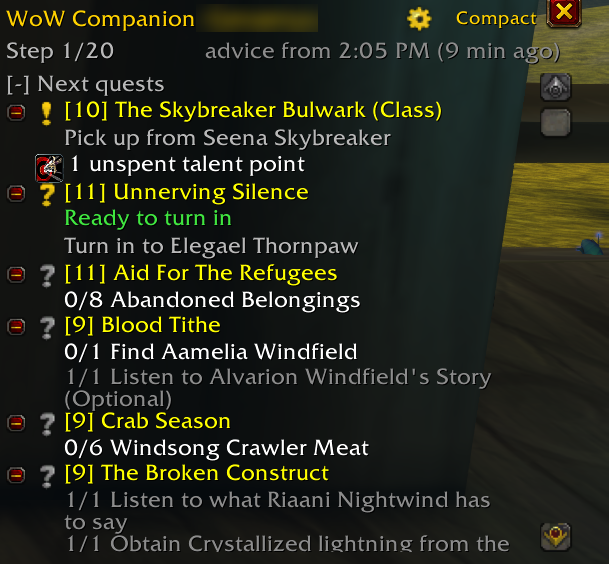
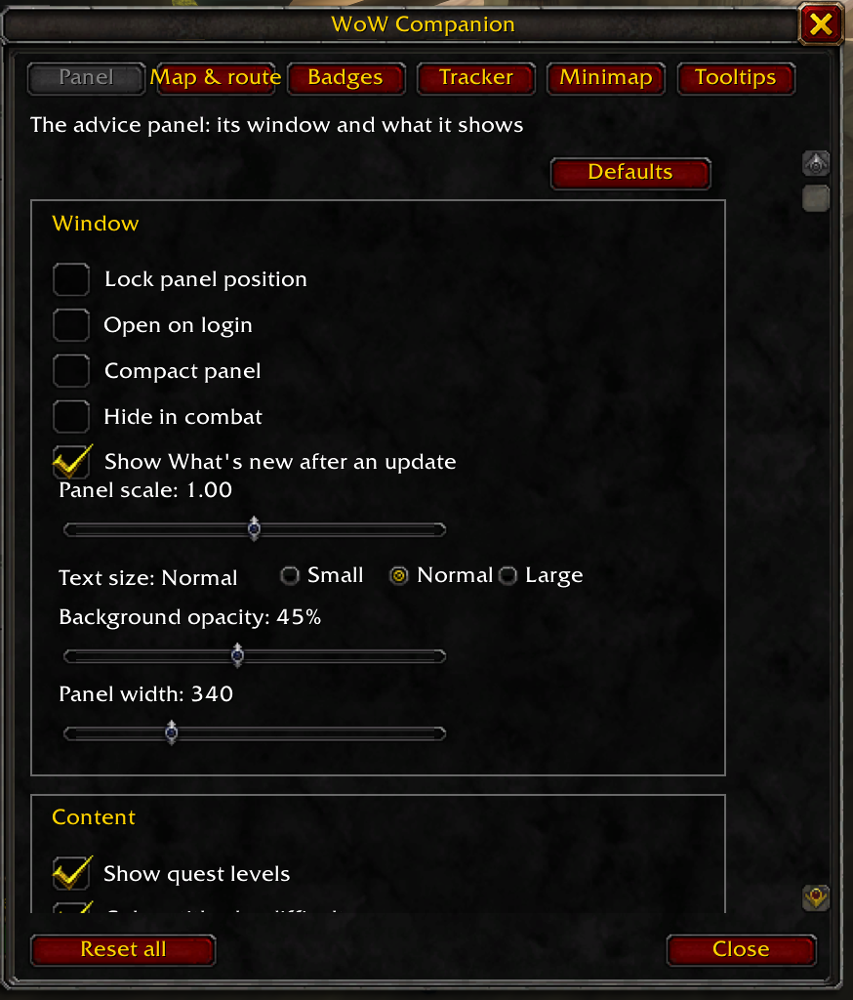

# Getting Started (Windows)

This guide takes you from nothing to your first plan in WoW. You do not need to know anything technical.
Where you see `<account>`, use your own WoW account name.

## What you'll get

A plan of what to do next, drawn on your map. You follow the numbers. You can also ask about your
character in plain words.

<!-- screenshot: map-plan.png — the world map with a numbered plan and the plan list open beside it -->

Two things do the work:

- **The WoW Companion app** is the small window that sits beside or over the game. It makes your plan and
  answers your questions.
- **The WoW Companion addon** is optional. It shows the plan inside the game.

You also need **ForeverScribe**. It is an addon that writes down what your character has. The app reads it.

**Safe to use:** the app never touches the game. Nothing is automated. Your AI sees only what you ask it.

## How long it takes

About 15 minutes. Most of that is installing one AI client and signing in. It's a one-time job.

## What you need

- [ ] **WoW: Forever** installed.
- [ ] **Windows 10 or 11 (64-bit).**
- [ ] **An account for one AI client.** This is the helper that writes the answers. You pick it in step 4.
  - Claude Code needs a Claude plan that includes it (Pro, Max, Team, Enterprise) or an Anthropic Console (API) account. The free Claude plan does not include it. See [Claude Code's setup page](https://code.claude.com/docs/en/setup).
  - Codex signs in with a ChatGPT plan or an API key ([Codex](https://github.com/openai/codex)).
  - For a Google account, use [Antigravity CLI](https://antigravity.google/docs/getting-started?tab=cli) (`agy`).
  - Gemini CLI is legacy. It works only with a paid Gemini API key ([Gemini CLI](https://github.com/google-gemini/gemini-cli)).
  - Prices change, so look on those pages.

## The steps

1. **Install ForeverScribe (required).** Open the [ForeverScribe page](https://github.com/MattMaximo/foreverscribe).
   Put the addon in your game's `_forever_\Interface\AddOns` folder.
   *You'll see a new ForeverScribe folder in AddOns.*
2. **Quit WoW completely, then start it again.** WoW only notices a new addon when it starts.
   *You'll see ForeverScribe in the addon list on the character screen.*
3. **Download the app.** On the [latest release](https://github.com/WoW-Companion/advisor/releases/latest)
   download `WoW-Companion-Setup-<version>-x64.exe`.
   *You'll see the file in your Downloads folder.*
4. **Run the installer.** It needs no admin rights. Windows SmartScreen (Windows' safety check) may say it
   "protected your PC". The installer is not code-signed. Click **More info**, then **Run anyway**.
   *You'll see WoW Companion in the Start menu.*
5. **Open the app and follow the setup checklist.** The app opens a **Setup** checklist with these lines:
   game found, ForeverScribe installed, ForeverScribe has data, WoW Companion addon (optional), display
   mode, Questie (optional), and game data. Fix any red line with the button next to it. If ForeverScribe is
   missing, the **Open ForeverScribe page** button takes you to it. The first time, the app downloads a small
   game-data file (under 1 MB) from GitHub. There is nothing to install.
   *You'll see a green ✓ next to each line you need.*

   <!-- screenshot: overlay-beside-game.png — the whole screen, with the game and the app beside it -->

   You can reopen the checklist later. Click the gear, then **Setup checklist**.
6. **Install an AI client and sign in once.** Pick one. Claude Code gives the most detailed answers in our
   testing. The steps for each are under [Set up your AI client](#set-up-your-ai-client) below.
   *You'll see the client's name in the app's AI box.*
7. **Set WoW to Windowed (Fullscreen).** In WoW, go to System, Graphics, **Display Mode**. Choose **Windowed (Fullscreen)**.
   *You'll see the app float over the game.*
8. **Type `/reload` once in the game.** That makes WoW save the file ForeverScribe wrote. The app can then read your character.
   *You'll see your character's name in the app, with a small green dot next to it.*

**Questie is optional, and recommended.** Questie is a popular quest addon. With Questie and QuestieDB
installed, the app suggests quests you have not picked up and shows where to get them. It reads them on your
own PC. Without them, the app uses ForeverScribe's data alone. See [Questie interop](design/questie-interop.md).
With Questie, the app also builds a numbered **Plan** under **Next**. It puts your pick-ups, objectives and
turn-ins in an efficient order.

## Ask your first question

<!-- screenshot: overlay-answer.png — a question asked in the app and its answer -->

In the app's ask box, type `What should I do next?` Then click **Ask**.
*You'll see the answer appear in the app within a few seconds.*

Not sure what to ask? Click one of the suggestions. The app also lists your next steps, upgrades (and how to
make an item) and talents.

You can also ask from the game. A question button there copies a question for you. Paste it into the ask
box with Ctrl+V, or click the paste button next to the box.

## In the game: what you'll see

This part needs the optional WoW Companion addon. The setup checklist can install it for you.
Type `/reload` in the game after it is installed.

- **The map.** A round button on the world map shows or hides your numbered steps and route. Follow the numbers.
- **The plan tab.** A tab at the lower right of the map opens the plan list. It shows in the side panel, like the quest log.
- **The minimap.** A marker shows your next step.
- **The panel.** Your next steps are in the panel. Open it with `/wowc`, or click the minimap button.

<!-- screenshot: map-route-closeup.png — the map zoomed in on a few numbered steps -->

<!-- screenshot: minimap-next-step.png — the minimap with the next-step marker -->

*The panel lists your next steps.*

Fresh advice shows after the app has written it. Type `/reload` to save. Wait a few seconds. Type `/reload` again.
The map button and plan tab need addon 0.6.23 or newer. The setup checklist updates the addon.

## Make it yours

In the game, right-click the minimap button, or type `/wowc options`. You can change how the panel and the route look.

*The addon's options: pick how the panel and route look.*

In the app, click the gear. The settings cover how the app looks, your AI, your play style, the game
connection and shortcuts.

## Set up your AI client

For every client the overlay finds it automatically. If it does not, press **Re-scan** in the overlay
settings (no restart needed), then press **Test** on the checklist's **AI client** line to confirm it
answers. Run PowerShell commands in a PowerShell window.

### Claude Code

- **Account:** a Claude plan that includes Claude Code, or an Anthropic Console account; the free Claude
  plan does not. See [Claude Code's setup page](https://code.claude.com/docs/en/setup).
- **Install:** `irm https://claude.ai/install.ps1 | iex`
- **Sign in once:** run `claude` in a terminal and follow the browser prompts. It must be signed in before
  it can answer headlessly.
- **Gotcha:** the installer puts `claude.exe` in `%USERPROFILE%\.local\bin`, which may not be on PATH, so
  `claude` may not work in a new terminal. The overlay looks there itself; add the folder to your user PATH
  only if you want to run `claude` in a terminal.

### Codex

- **Account:** a ChatGPT plan that includes Codex, or an API key. See [Codex](https://github.com/openai/codex).
- **Install:** `powershell -ExecutionPolicy ByPass -c "irm https://chatgpt.com/codex/install.ps1 | iex"`
- **Sign in once:** run `codex` and choose **Sign in with ChatGPT**.
- **Gotcha:** none known. If you install it while the overlay is open, just press **Re-scan**.

### Antigravity CLI (`agy`)

- **Account:** a Google account (free, Google AI Pro or Ultra). It replaced Gemini CLI for these accounts
  on June 18, 2026. See [Antigravity CLI](https://antigravity.google/docs/getting-started?tab=cli).
- **Install:** `irm https://antigravity.google/cli/install.ps1 | iex`
- **Sign in once:** run `agy` in a terminal and follow its prompts.
- **Gotcha:** run `wowc-advisor setup agy --write` once, so `agy` may use the advisor's read-only tools.

### Gemini CLI (legacy)

- **Account:** a paid Gemini API key or an Enterprise license only. See [Gemini CLI](https://github.com/google-gemini/gemini-cli).
- **Install:** `npm install -g @google/gemini-cli`
- **Sign in once:** set your `GEMINI_API_KEY` environment variable, or run `gemini` once.
- **Gotcha:** it does not work with a free or Google AI Pro/Ultra account any more; use Antigravity CLI.

## Permissions and safety

- It installs for your Windows user only. No admin rights.
- The overlay never touches the game process. It is a separate window that sits above WoW.
- It reads the file ForeverScribe saved. WoW writes that file when you `/reload`.
- It writes only to the WoW Companion addon folder, and only if you choose to install the addon.
- The AI client runs with only the advisor's read-only tools.
- Network calls: GitHub, to check for and download releases, and your AI client's own service. Nothing else.

## If something's not right

- **If the app is not over the game,** then set Display Mode to **Windowed (Fullscreen)**.
- **If the AI box says "Auto (none found)",** then install a client ([steps](#set-up-your-ai-client)), sign in once, and press **Re-scan**.
- **If the checklist says ForeverScribe has no data,** then type `/reload` in the game and reopen the checklist.
- **If the app says it can't find WoW,** then use the checklist's folder box to point it at your game folder.
- **If the map has no numbered steps,** then type `/reload`, wait a few seconds, and type it again. Also check the round map button is on.

More help: the [quickstart FAQ](quickstart.md#faq-and-troubleshooting).

## Send feedback

[Open the alpha feedback form](https://github.com/WoW-Companion/advisor/issues/new?template=alpha-feedback.yml).
Screenshots help. Before you attach one, check it does not show your account name, your character's name
or other players' names. Crop or blur them.
